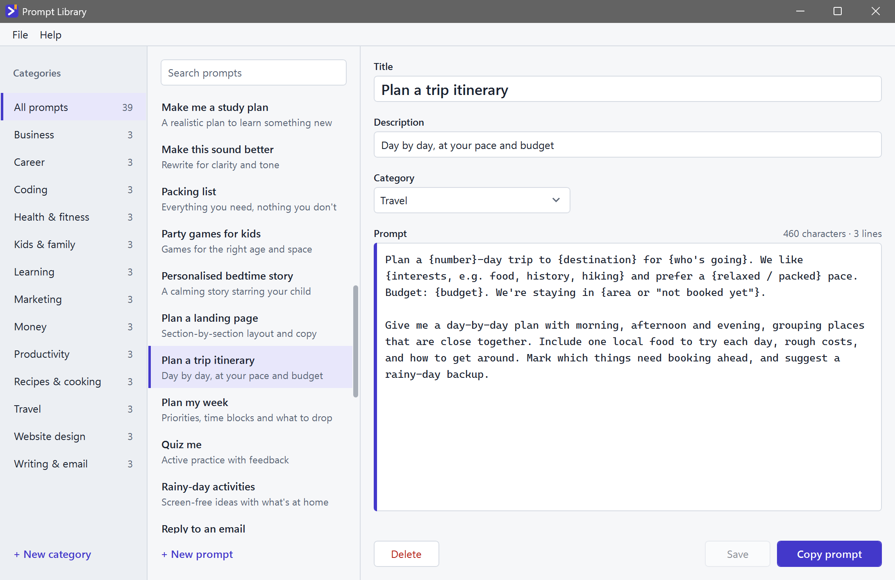
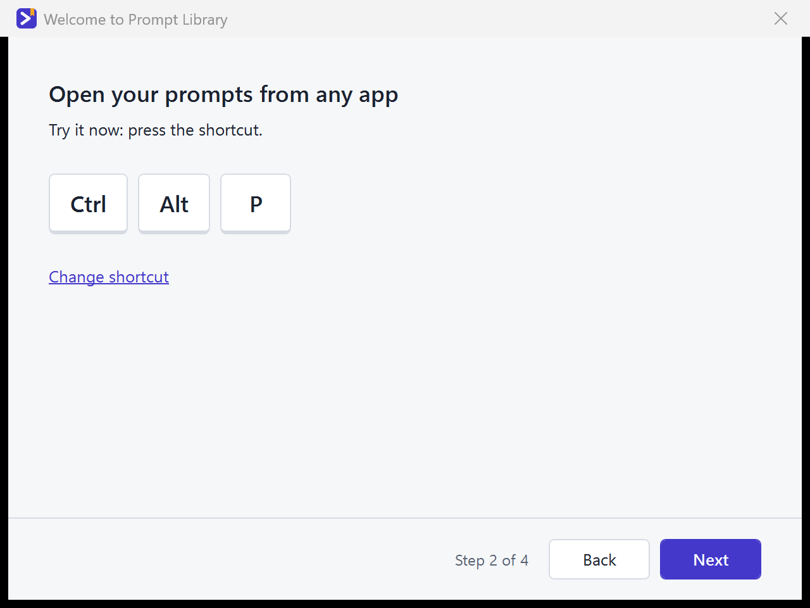

# Prompt Library

A Windows tray app that keeps your AI prompts in one place. Press a global shortcut from any app, pick a category and a prompt, and it is copied to the clipboard and pasted where you were typing (terminal, browser, IDE, Claude Code).



The first run shows a short setup wizard (shortcut, backups, paste behaviour).



## Install

Run `PromptLibrary-Setup.msi`. It installs just for you (no admin rights needed) to `%LOCALAPPDATA%\Programs\Prompt Library`, adds `Prompt Library` to the Start menu and to Settings → Apps, and on its last page starts the app, whose setup wizard picks your shortcut and backups. The app starts with Windows (you can turn this off in Settings). To update, run a newer installer: a running Prompt Library is closed and replaced, and your prompts and settings are kept.

The installer isn't code-signed yet, so Windows SmartScreen may say "Windows protected your PC" (unknown publisher) when you open the download. Choose **More info**, then **Run anyway**.

You can also skip the installer: build the exe yourself (see Publish) and run `publish\PromptLibrary.exe`. It is self-contained: no .NET install needed.

## Use

- **Shortcut:** `Ctrl+Alt+P` (changeable in Settings) opens the quick menu at the mouse. Click the tray icon for the same menu.
- **Auto-paste:** picking a prompt copies it and pastes it into the app you were using. Hold `Ctrl+Alt` while picking to copy only. Turn auto-paste off in Settings to always copy only. Apps running as administrator can't be pasted into; the prompt is still copied.
- **Main window:** tray menu, Open Prompt Library. Add, edit, search, move and delete prompts and categories.

## Build, run, test

Requires the .NET 10 SDK.

```
dotnet build
dotnet run --project src/PromptLibrary.App
dotnet test
```

## Publish

```
dotnet publish src/PromptLibrary.App -c Release -o publish
```

Produces a single self-contained file, `publish/PromptLibrary.exe` (win-x64, about 72 MB).

### Installer

```
.\build\build-installer.ps1
```

Publishes the exe as above, then builds `installer/PromptLibrary.Installer.wixproj` (WiX Toolset v5 from NuGet; nothing to install) and writes `artifacts/PromptLibrary-Setup.msi`. The installer's version is the exe's: bump `<Version>` in `src/PromptLibrary.App/PromptLibrary.App.csproj` for each release (or pass `-Version 1.0.1` for a one-off build). The installer project isn't in `PromptLibrary.sln`, so `dotnet build` and `dotnet test` stay fast. The page art in `installer/Assets` is drawn by `python build/make-installer-bitmaps.py` (needs Pillow).

## Where your data lives

`%APPDATA%\PromptLibrary\`: `library.json` (prompts and categories) and `settings.json` (this PC's settings, never backed up).

## Backups

Backups are copies of `library.json` in a folder you choose. Google Drive, OneDrive, Dropbox and iCloud Drive folders are detected automatically, or pick any folder. The app backs up after changes and on a schedule, keeps the most recent ones, and can restore any of them (File menu, Restore). If the folder can't be reached (for example a paused sync), the main window shows a notice.

## Uninstall

Settings → Apps → Prompt Library → Uninstall. It closes the app and removes it, its Start-menu shortcut and its start-with-Windows entry. Uninstalling keeps your prompts and backups: your library stays in `%APPDATA%\PromptLibrary\` until you delete that folder.

Without the installer: turn off "Start Prompt Library when Windows starts" in Settings (or delete the `PromptLibrary` value under `HKCU\Software\Microsoft\Windows\CurrentVersion\Run`), exit from the tray menu, and delete the exe.

## Testing

Manual checks that need a real desktop: [docs/manual-test-checklist.md](docs/manual-test-checklist.md).

## License

To be decided.
