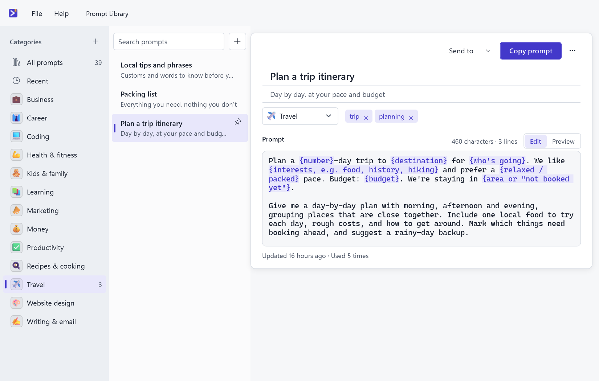
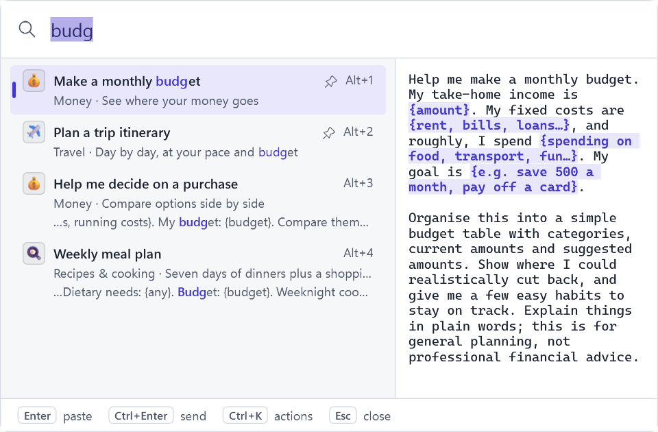
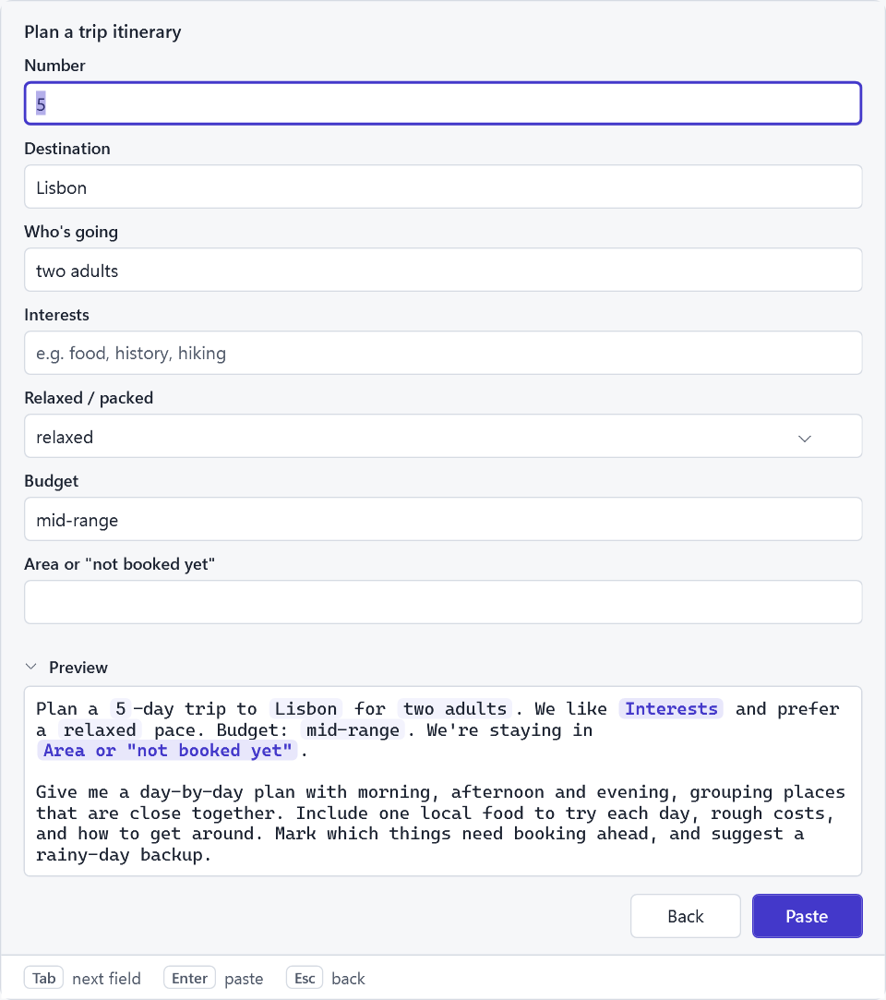
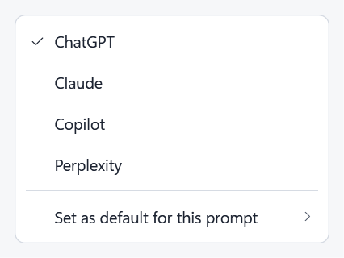
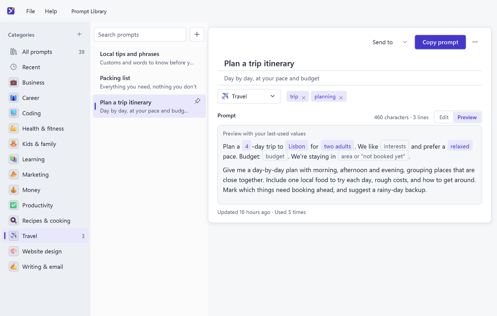
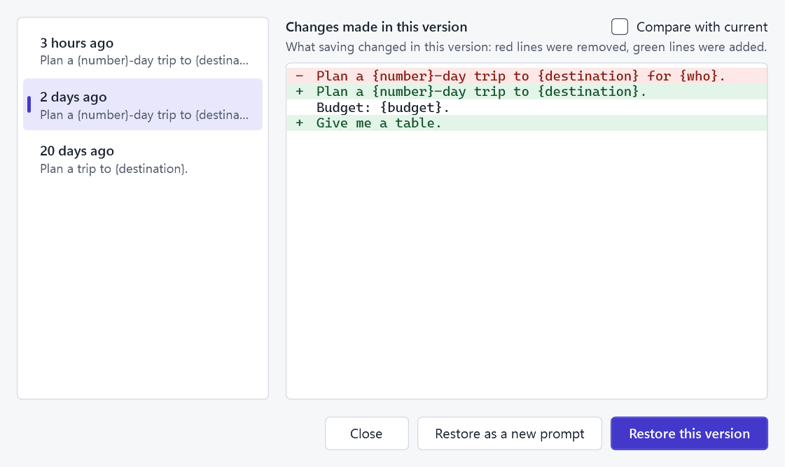
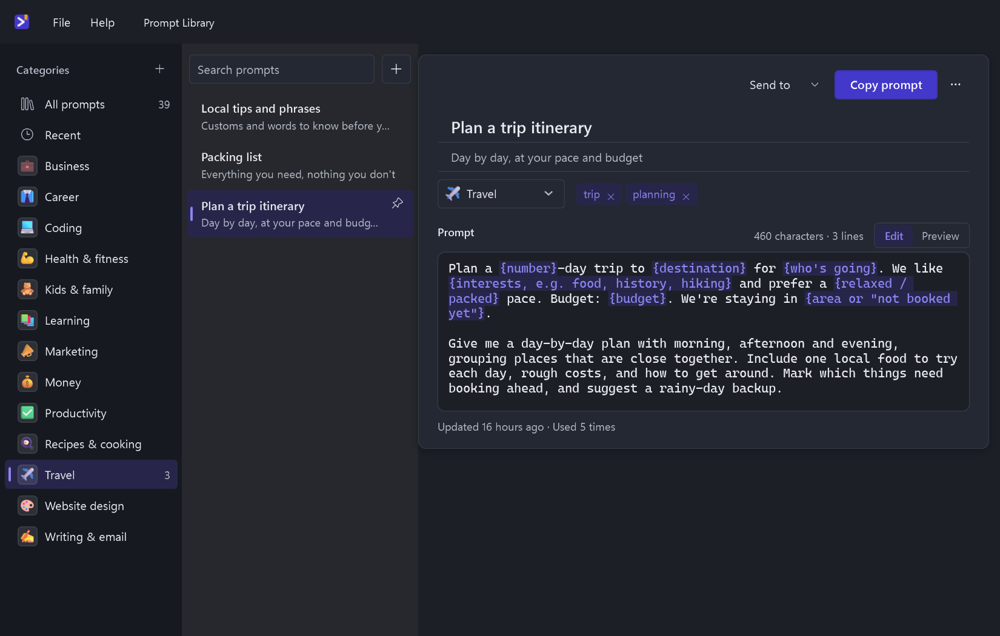
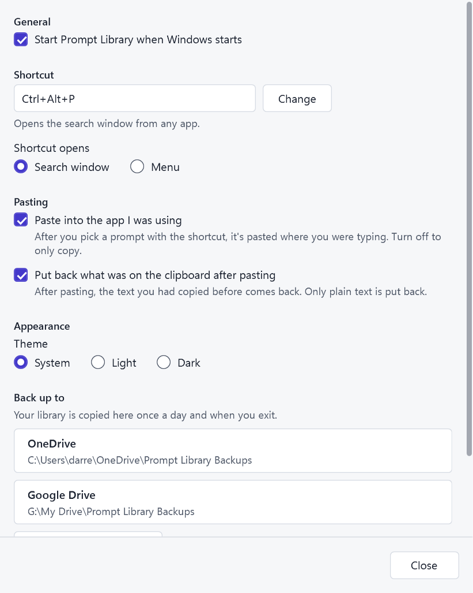
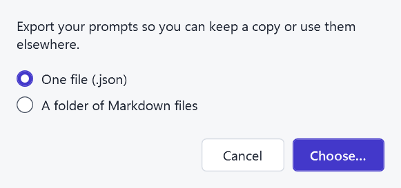
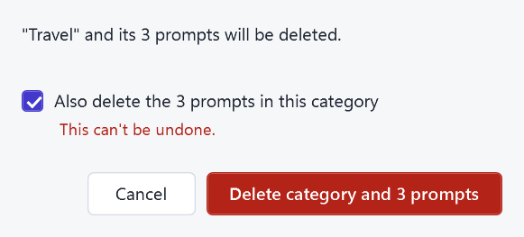

# Prompt Library

### Your best AI prompts, one shortcut away.

Press <kbd>Ctrl</kbd> + <kbd>Alt</kbd> + <kbd>P</kbd> in any app, type a few letters, hit <kbd>Enter</kbd>. 
Your prompt is pasted right where you were typing.

  

  
  
  
  
  
  

  <a href="#get-started">Get started</a> ·
  <a href="#why-prompt-library">Why Prompt Library</a> ·
  <a href="#keyboard-shortcuts">Shortcuts</a> ·
  <a href="#questions">Questions</a> ·
  <a href="#help-and-feedback">Help</a>

 

> **New in 1.2.1:** clearer for first-time users (labelled buttons, a visible save state, plainer words), colour icons on every category with 18 new business icons, and Settings → Delete all my prompts to start fresh.
>
> **New in 1.2:** prompt templates with a live preview, ranked search, version history, import and export, and a new Windows 11 look in light and dark. [See the changelog](CHANGELOG.md).

## Three keystrokes

<table>
  <tr>
    <td width="33%" align="center"><h3>1. Press</h3><kbd>Ctrl</kbd> + <kbd>Alt</kbd> + <kbd>P</kbd> in any app: browser, terminal, IDE, chat.</td>
    <td width="33%" align="center"><h3>2. Type</h3>A few letters of the title, a word from the text, even with a typo.</td>
    <td width="33%" align="center"><h3>3. Enter</h3>The prompt is pasted where you were typing. Edit it and send.</td>
  </tr>
</table>

  

 

## Everything between you and a great prompt

<table>
  <tr>
    <td width="50%" valign="top">
      <h3>🔎 Find it instantly</h3>
      
Pinned and recent prompts are waiting when you open the search window. Start typing and results rank as you go, forgiving small typos. Add <code>#tag</code> or <code>cat:recipes</code> to narrow down, press <kbd>Alt</kbd> + <kbd>1</kbd>…<kbd>9</kbd> to pick a result, and see a preview before you paste.

    </td>
    <td width="50%"></td>
  </tr>
  <tr>
    <td width="50%"></td>
    <td width="50%" valign="top">
      <h3>✍️ Fill in the blanks</h3>
      
Write <code>{name}</code> where your details go, or <code>{formal / friendly}</code> for a choice list, or <code>{topic, e.g. coffee}</code> for a hint. A small form asks for each one, remembers your last answer and shows the finished prompt as you type.

      
Built-ins fill themselves: <code>{clipboard}</code>, <code>{date}</code> and <code>{time}</code>. <code>{cursor}</code> parks the caret where you want to keep typing.

    </td>
  </tr>
  <tr>
    <td width="50%" valign="top">
      <h3>⌨️ Pastes where you're typing</h3>
      
It pastes into the app you came from, then puts back whatever was on your clipboard. If an app can't be pasted into (apps running as administrator, for example), the prompt is copied instead and you press <kbd>Ctrl</kbd> + <kbd>V</kbd>.

    </td>
    <td width="50%" valign="top">
      <h3>🚀 Send to your AI</h3>
      
Open the prompt in ChatGPT, Claude, Copilot or Perplexity with one click. It's also copied, in case the site wants it pasted. Choose a default for each prompt, then <kbd>Ctrl</kbd> + <kbd>Enter</kbd> in the search window does the rest.

    </td>
  </tr>
  <tr>
    <td width="50%"></td>
    <td width="50%"></td>
  </tr>
  <tr>
    <td width="50%" valign="top">
      <h3>🗂️ Organise your way</h3>
      
Your own categories (with an emoji if you like), tags, pins and a <b>Recent</b> list. The editor highlights placeholders, headings and code, and <b>Preview</b> shows the prompt with your remembered values filled in.

    </td>
    <td width="50%" valign="top">
      <h3>🕘 Never lose a version</h3>
      
Every save keeps the one before it (the last 50). Open <b>Version history…</b>, see exactly what changed, and restore an older version. Unsaved edits are rescued too, even if Windows logs off.

    </td>
  </tr>
  <tr>
    <td width="50%"></td>
    <td width="50%"></td>
  </tr>
  <tr>
    <td width="50%" valign="top">
      <h3>🌗 Looks at home on Windows</h3>
      
Light and dark follow your Windows setting (or pick one in Settings). On Windows 11 you get the Mica backdrop and rounded corners. Prefer the classic native menu? Choose it under <b>Settings → Shortcut opens</b>.

    </td>
    <td width="50%" valign="top">
      <h3>📦 Yours to keep</h3>
      
Export everything as one JSON file, or as a folder of Markdown files you can open anywhere. Import the same way. Cloud backups find your OneDrive, Google Drive, Dropbox or iCloud Drive folder by themselves.

    </td>
  </tr>
  <tr>
    <td width="50%"></td>
    <td width="50%"></td>
  </tr>
  <tr>
    <td width="50%" valign="top">
      <h3>👥 Share with your team</h3>
      
Keep the team's proven prompts in a shared folder and everyone gets them in search and in the main window. They update by themselves, work offline and keep their own history. Your prompts stay yours.

    </td>
    <td width="50%" valign="top">
      <h3>🔒 Private by design</h3>
      
No account, no sign-in, no tracking. Your prompts live on your PC and in the backup folder you choose. <b>Sending opens that AI site in your browser with the prompt text; nothing is sent unless you choose Send.</b>

    </td>
  </tr>
</table>

 

## Why Prompt Library

| | Notes app | Browser extension | Chat history | **Prompt Library** |
| --- | :---: | :---: | :---: | :---: |
| Works in every app, not just one site | Copy and paste by hand | One browser only | One chat service only | **One shortcut, anywhere you can type** |
| Fill-in fields and choice lists | No | Varies | No | **Yes** |
| Finds it with a typo | Varies | Varies | Varies | **Yes** |
| Plain files you can take away | Varies | Varies | No | **JSON or Markdown export** |
| Needs an account | Varies | Varies | Yes | **No** |

 

## Keyboard shortcuts

| Where | Keys | What it does |
| --- | --- | --- |
| Anywhere | <kbd>Ctrl</kbd> + <kbd>Alt</kbd> + <kbd>P</kbd> | Open Prompt Library (you can change it in Settings) |
| Search window | <kbd>Enter</kbd> | Paste the selected prompt |
| Search window | <kbd>Ctrl</kbd> + <kbd>Enter</kbd> | Send to the prompt's default AI (ChatGPT if none is set) |
| Search window | <kbd>Alt</kbd> + <kbd>1</kbd>…<kbd>9</kbd> | Use the 1st to 9th result |
| Search window | <kbd>Ctrl</kbd> + <kbd>K</kbd> | Actions for the selected prompt |
| Search window | <kbd>Ctrl</kbd> + <kbd>O</kbd> | Open it in the main window |
| Search window | <kbd>Esc</kbd> | Clear the search; press again to close |
| Main window | <kbd>Ctrl</kbd> + <kbd>N</kbd> / <kbd>Ctrl</kbd> + <kbd>S</kbd> | New prompt / save |
| Main window | <kbd>Ctrl</kbd> + <kbd>F</kbd> | Search |
| Main window | <kbd>Ctrl</kbd> + <kbd>Shift</kbd> + <kbd>C</kbd> | Copy prompt |
| Main window | <kbd>Ctrl</kbd> + <kbd>Shift</kbd> + <kbd>Enter</kbd> | Send to the default AI |
| Main window | <kbd>F6</kbd> | Move between categories, list and editor |
| Main window | <kbd>F2</kbd> / <kbd>Delete</kbd> | Rename / delete the selected category or prompt |

 

## Get started

1. **[Download the installer](https://github.com/darretking/prompt-library/releases/latest)** (`PromptLibrary-Setup.msi`, Windows 10 or 11).
2. **Run it.** It installs just for you, so no admin rights are needed. If Windows says "Windows protected your PC", choose **More info**, then **Run anyway** (the installer isn't code-signed yet).
3. **Follow the short setup.** It has you try the shortcut, offers to join or start a team library (or skip), asks where to keep backups, and asks whether to start Prompt Library when Windows starts. You can run it again any time from **Help → Setup guide…**.
4. **Press <kbd>Ctrl</kbd> + <kbd>Alt</kbd> + <kbd>P</kbd>** in any app and pick one of the 39 starter prompts. It's pasted where you were typing.

**Add your own prompt.** Open the main window (double-click the tray icon, or use the Start menu), choose **+ New prompt** (<kbd>Ctrl</kbd> + <kbd>N</kbd>), add a title, a category and the prompt text, and **Save** (<kbd>Ctrl</kbd> + <kbd>S</kbd>). It's in the search window straight away.

**In the tray.** Prompt Library waits in the notification area. Left-click its icon to open the search window; right-click for **Open Prompt Library…**, **Settings…** and **Exit**.

<table>
  <tr>
    <td></td>
    <td></td>
  </tr>
  <tr>
    <td></td>
    <td></td>
  </tr>
</table>

  
Prefer a single file, no installer?

   
  Build <code>PromptLibrary.exe</code> yourself (see <a href="docs/DEVELOPMENT.md">Developing Prompt Library</a>) and run it. It's self-contained: no .NET install needed.

 

## Made for people who use AI every day

You start with 39 ready-made prompts across 13 categories, so it's useful from the first minute: marketing, planning, learning, careers, travel, coding and more.

  
<b>See all 39 starter prompts</b>

   

| Category | Prompts |
| --- | --- |
| Marketing | Social media content calendar · Ad copy in five angles · Ideal customer profile |
| Website design | Plan a landing page · Review my homepage · Colours and fonts |
| Productivity | Plan my week · Break down a big task · Turn notes into actions |
| Kids & family | Party games for kids · Rainy-day activities · Personalised bedtime story |
| Recipes & cooking | Cook with what I have · Weekly meal plan · Adapt a recipe |
| Business | Test a business idea · SWOT analysis · Set my prices |
| Writing & email | Reply to an email · Make this sound better · Summarise this |
| Learning | Explain it simply · Make me a study plan · Quiz me |
| Health & fitness | Beginner workout plan · Build a healthy habit · Desk stretch routine |
| Travel | Plan a trip itinerary · Packing list · Local tips and phrases |
| Money | Make a monthly budget · Savings goal plan · Help me decide on a purchase |
| Career | Tailor my CV to a job · Interview practice · Ask for a raise |
| Coding | Explain this code · Fix this error · Review my code |

Each one has `{placeholders}` where your details go, tells the AI exactly what to produce, and is yours to edit, rename or delete.

 

## Team prompts

One person keeps the team's proven prompts in a shared folder (a network drive, or a OneDrive, Google Drive or Dropbox folder) and everyone gets them, in the main window and in search. Team prompts update by themselves, keep working offline, and can't be changed by accident.

<table>
  <tr>
    <td></td>
    <td></td>
  </tr>
  <tr>
    <td></td>
    <td></td>
  </tr>
</table>

  
<b>How a team shares prompts</b>

   
  One person chooses Settings → Team prompts → <b>Start a team library</b>, picks a folder the team can open and names it. They can begin with 24 example business prompts or copy in their own categories. Everyone else chooses <b>Join a team library</b> and picks the same folder. A direct link to the file also works (a GitHub raw link or a Dropbox link); OneDrive and Google Drive share pages aren't direct links, so use the synced folder for those.  
  Switch between <b>Your prompts</b> and <b>Team prompts</b> with <kbd>Ctrl</kbd> + <kbd>1</kbd> / <kbd>Ctrl</kbd> + <kbd>2</kbd>. Team prompts open read only. <b>Make my copy</b> gives you your own version to change, <b>Pin</b> keeps favourites at the top, and <b>Hide</b> tidies away the ones you don't use.  
  Whoever can change files in the shared folder sees <b>Edit team library</b>: every save goes to everyone. If someone else saved first, your change is kept and you save again. Every save keeps a copy, so <b>Restore an older version</b> undoes anything.

  
<b>What if the team folder can't be reached?</b>

   
  Team prompts keep working from the last copy your PC saw. The Team side says when it last updated, with <b>Retry</b>. When the folder is back, new and changed prompts arrive by themselves.

  
<b>What happens if I leave a team library?</b>

   
  Settings → Team prompts → <b>Leave team library</b>. The team's prompts disappear from your PC; any copies you made with <b>Make my copy</b> stay in your own prompts. Nothing changes for the rest of the team.

 

## Backups, updates and your data

  
<b>Backups and restore</b>

   
  Turn on cloud backup in Settings. Prompt Library finds your OneDrive, Google Drive, Dropbox or iCloud Drive folder by itself, and copies your library there once a day and when you exit. On a new PC, install Prompt Library, choose <b>File → Restore from backup…</b> and pick that folder. Before any restore, your current library is kept as a safety copy.

  
<b>Updates</b>

   
  Prompt Library asks GitHub once a day whether a newer version exists (or choose Help → Check for updates…). Nothing about you or your prompts is sent. When one is out, choose <b>Update now</b>: it downloads the installer, checks it, closes the app safely and installs. Your prompts and settings are kept. Versions before 1.0.2 don't have this, so install 1.0.2 or later by hand once. See <a href="CHANGELOG.md">what's new in each version</a>.

  
<b>Where is my data?</b>

   
  On your PC, in <code>%APPDATA%\PromptLibrary</code> (<code>library.json</code> is your library). With backups on, a copy also goes to the folder you chose.

  
<b>Uninstall</b>

   
  Windows Settings → Apps → Installed apps → Prompt Library → <b>Uninstall</b>. That removes the app, its Start menu shortcut and its "start with Windows" entry. Your prompts and backups are kept, so reinstalling picks up where you left off. To remove them too, delete the <code>%APPDATA%\PromptLibrary</code> folder.

 

## Questions

  
<b>Which apps does it work with?</b>

   
  Any app where you can type: browsers (ChatGPT, Claude, Gemini, Copilot on the web), Claude Code, VS Code, Windows Terminal, Notepad, Word, Slack. The exception is apps running as administrator. Windows doesn't let normal apps type into them, so the prompt is copied and you press <kbd>Ctrl</kbd> + <kbd>V</kbd>.

  
<b>Can I just copy, without the automatic paste?</b>

   
  Yes. Turn off "Paste into the app I was using" in Settings, and picking a prompt only copies it.

  
<b>The shortcut does nothing. What now?</b>

   
  Another app probably took <kbd>Ctrl</kbd> + <kbd>Alt</kbd> + <kbd>P</kbd> first; Prompt Library shows a notice when that happens. Open Settings, choose <b>Change</b> next to Shortcut and press a new combination. If that one is taken too, it tells you and suggests a free one. Meanwhile, clicking the tray icon opens the search window.

  
<b>Can I delete a category and its prompts together?</b>

   
  Yes. Deleting a category that has prompts lets you move them to another category or tick <b>Also delete the prompts in this category</b>.
    
  

  
<b>Does it send my prompts anywhere?</b>

   
  No. Prompts stay on your PC. Only if you choose <b>Send to</b> does Prompt Library open that AI site in your browser with the prompt text. The daily update check only asks GitHub for the latest version number.

  
<b>Why not a right-click menu inside other apps?</b>

   
  Windows doesn't allow one app to add items to another app's right-click menu. A single shortcut works the same everywhere instead.

  
<b>Is it free?</b>

   
  Yes. No account, no subscription. It's open source under the GNU GPL v3: you can use, study, change and share it, and anyone who shares a changed version must share its source code too.

 

## Help and feedback

- 🐛 [Report a bug or suggest an idea](https://github.com/darretking/prompt-library/issues)
- 📦 [Download the latest version](https://github.com/darretking/prompt-library/releases/latest)
- 📝 [Changelog: what's new in each version](CHANGELOG.md)
- 🧭 In the app: **Help → Setup guide…** runs setup again; **Help → Check for updates…** looks for a new version now.

## For developers

Prompt Library is a C# / WPF app on .NET 10 with a fully tested core library. Build instructions, the project layout, the installer and the roadmap are in **[Developing Prompt Library](docs/DEVELOPMENT.md)**.

 

  Made by <a href="https://github.com/darretking">@darretking</a> · Free and open source under the <a href="LICENSE">GNU GPL v3</a>

