

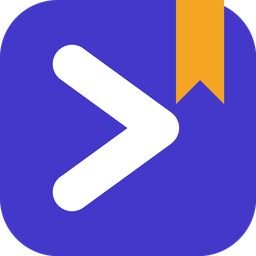

# Prompt Library

### Your best AI prompts, one shortcut away.

Press <kbd>Ctrl</kbd> + <kbd>Alt</kbd> + <kbd>P</kbd> in any app, pick a prompt, and it's pasted right where you were typing. 
ChatGPT, Claude, Copilot, your terminal, your IDE: one library for all of them.

  

  
  
  
  
  

  <a href="#get-started">Get started</a> ·
  <a href="#how-it-works">How it works</a> ·
  <a href="#share-best-practice-prompts-with-your-team">Team prompts</a> ·
  <a href="#questions">Questions</a> ·
  <a href="#help-and-feedback">Help</a>

 

## Stop hunting for that prompt

You've written a prompt that works. Then it disappears into a notes app, a chat history, a text file on the desktop, a doc you can't find. Next time you need it, you rewrite it from memory, and it's never quite as good.

**Prompt Library keeps every prompt in one place and puts it in front of you the moment you need it,** without leaving the app you're in.

 

## How it works

<table>
  <tr>
    <td width="33%" align="center"><h3>1. Press the shortcut</h3><kbd>Ctrl</kbd> + <kbd>Alt</kbd> + <kbd>P</kbd> in any app: browser, terminal, IDE, chat window.</td>
    <td width="33%" align="center"><h3>2. Pick a prompt</h3>A menu opens at your mouse. Choose a category, then the prompt.</td>
    <td width="33%" align="center"><h3>3. It's pasted</h3>Straight into the box you were typing in. Edit it and hit send.</td>
  </tr>
</table>

  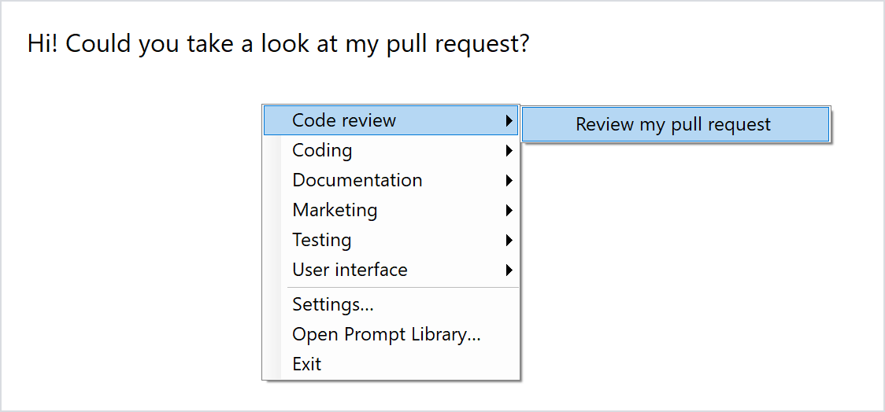

 

## Get started

1. **[Download the installer](https://github.com/darretking/prompt-library/releases/latest)** (`PromptLibrary-Setup.msi`, Windows 10 or 11).
2. **Run it.** It installs just for you, so no admin rights are needed. If Windows says "Windows protected your PC", choose **More info**, then **Run anyway** (the installer isn't code-signed yet).
3. **Follow the short setup.** It has you try the shortcut, offers to join or start a team library (or skip), and asks where to keep backups. You can run it again any time from **Help → Setup guide…**.
4. **Press <kbd>Ctrl</kbd> + <kbd>Alt</kbd> + <kbd>P</kbd>** in any app and pick one of the 39 starter prompts. It's pasted where you were typing.

**Add your own prompt.** Double-click the Prompt Library icon in the taskbar's notification area (or open it from the Start menu) to open the main window. Choose **+ New prompt** (<kbd>Ctrl</kbd> + <kbd>N</kbd>), give it a title, a category and the prompt text, and **Save** (<kbd>Ctrl</kbd> + <kbd>S</kbd>). It's in the shortcut menu straight away.

The app starts with Windows and waits in the notification area. Clicking its icon opens the same menu as the shortcut, plus **Open Prompt Library…**, **Settings…** and **Exit**.

<table>
  <tr>
    <td>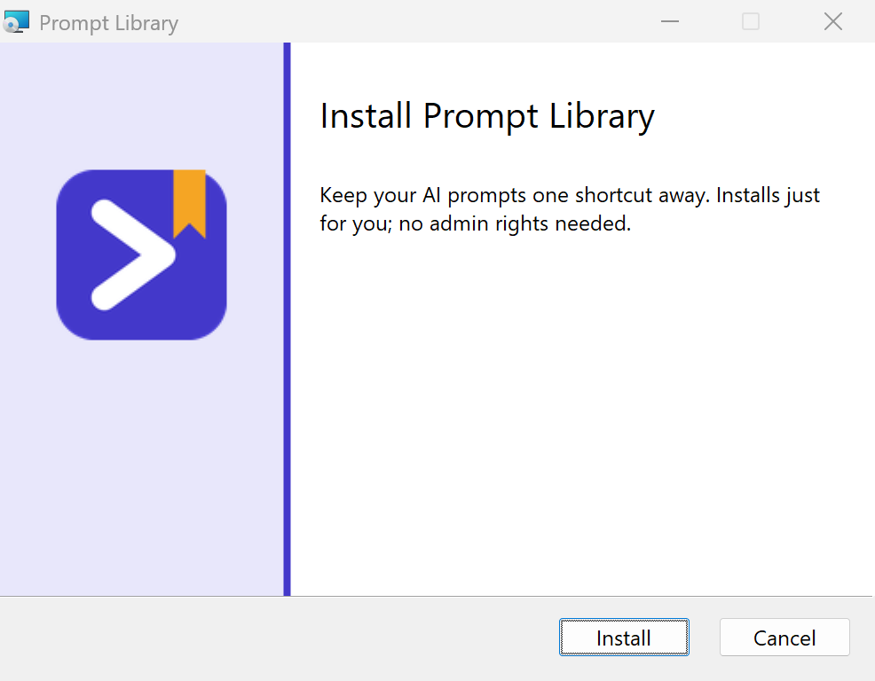</td>
    <td>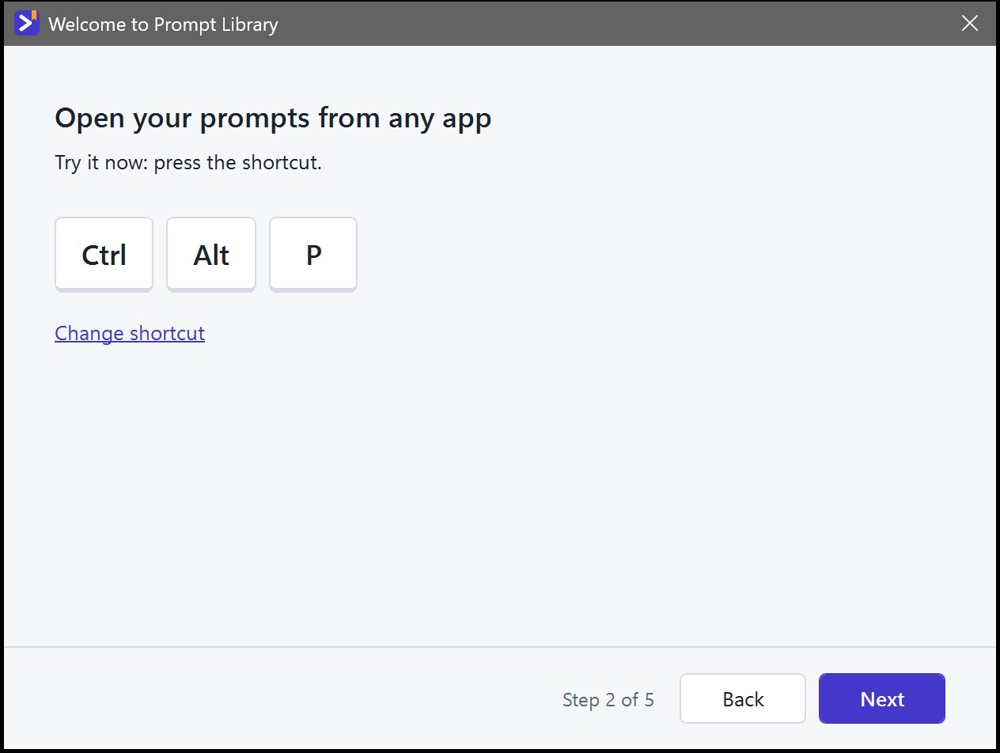</td>
  </tr>
  <tr>
    <td>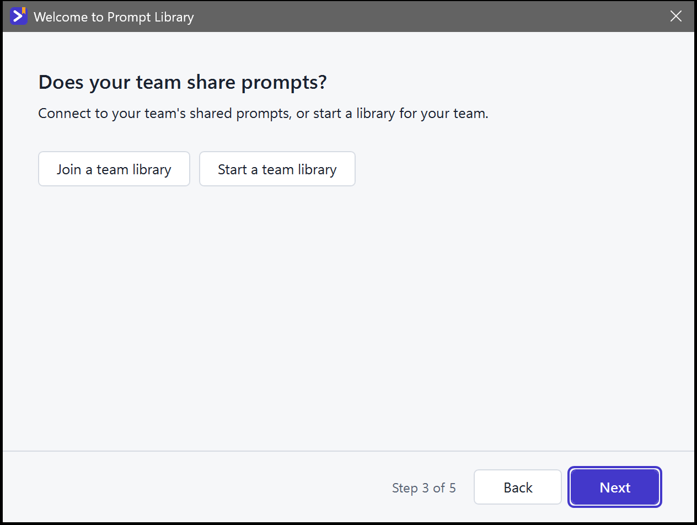</td>
    <td>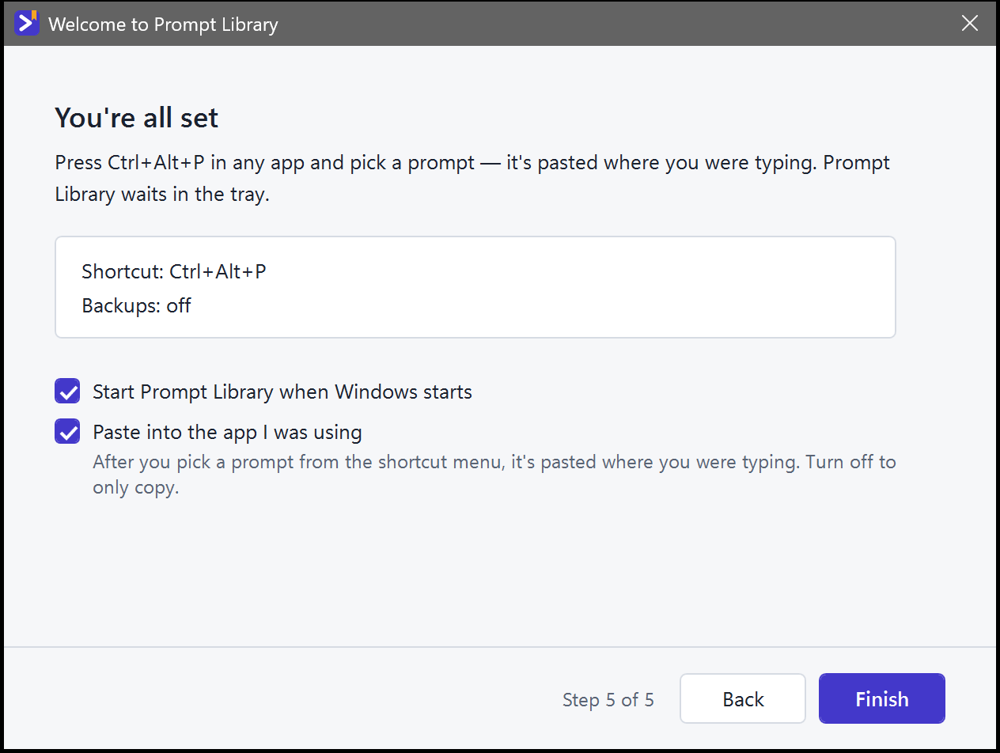</td>
  </tr>
</table>

  
Prefer a single file, no installer?

   
  Build <code>PromptLibrary.exe</code> yourself (see <a href="docs/DEVELOPMENT.md">Developing Prompt Library</a>) and run it. It's self-contained: no .NET install needed.

 

## Everything you need, nothing you don't

<table>
  <tr>
    <td width="50%" valign="top">
      <h3>⚡ Works in every app</h3>
      
One shortcut, everywhere. No browser extension, no plugin per tool, no copy-paste dance. If you can type in it, Prompt Library can paste into it.

    </td>
    <td width="50%" valign="top">
      <h3>🔎 Find any prompt in a second</h3>
      
Search across titles, descriptions and the prompt text itself. Organise prompts into your own categories: Marketing, Recipes, Travel, Coding, whatever fits your life and work.

    </td>
  </tr>
  <tr>
    <td>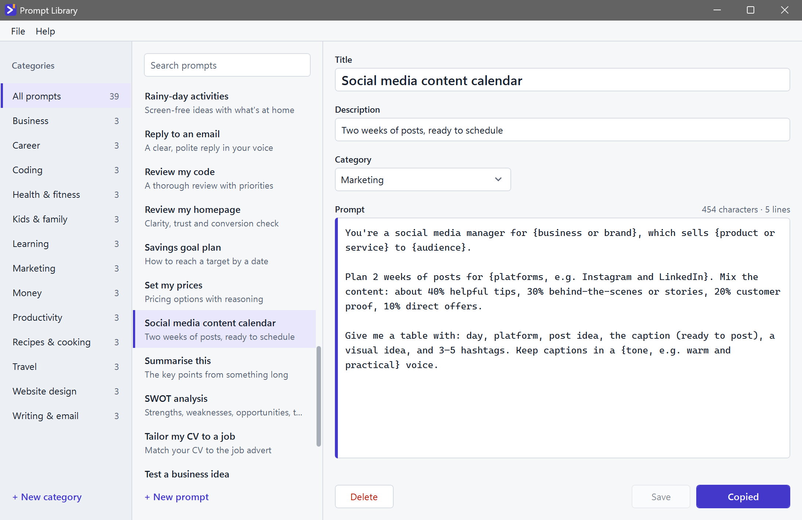</td>
    <td>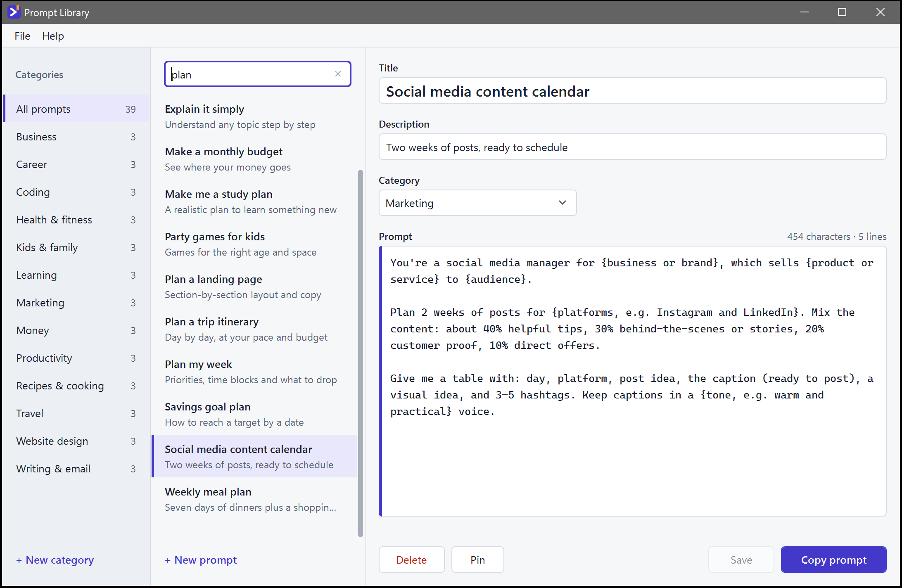</td>
  </tr>
  <tr>
    <td width="50%" valign="top">
      <h3>✍️ Write once, reuse forever</h3>
      
A clean editor that keeps your prompt exactly as you wrote it: line breaks, tabs, code blocks, quotes and emoji. What you see is exactly what gets pasted.

    </td>
    <td width="50%" valign="top">
      <h3>☁️ Backups that set themselves up</h3>
      
Prompt Library finds your OneDrive, Google Drive, Dropbox or iCloud Drive folder by itself. One click, and your library is backed up every day. A new PC? Restore it in seconds.

    </td>
  </tr>
  <tr>
    <td>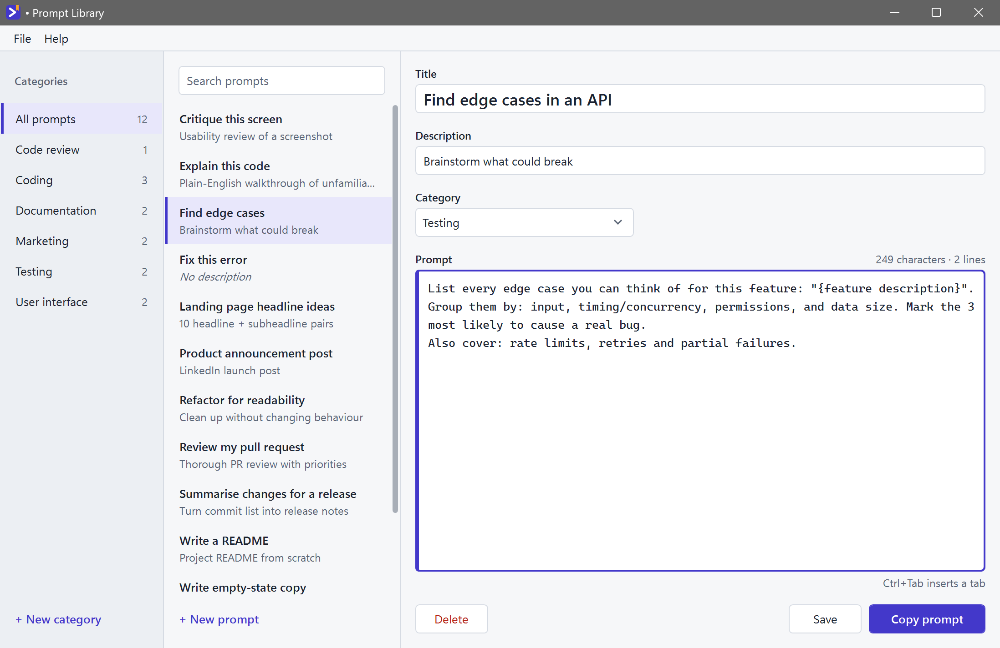</td>
    <td>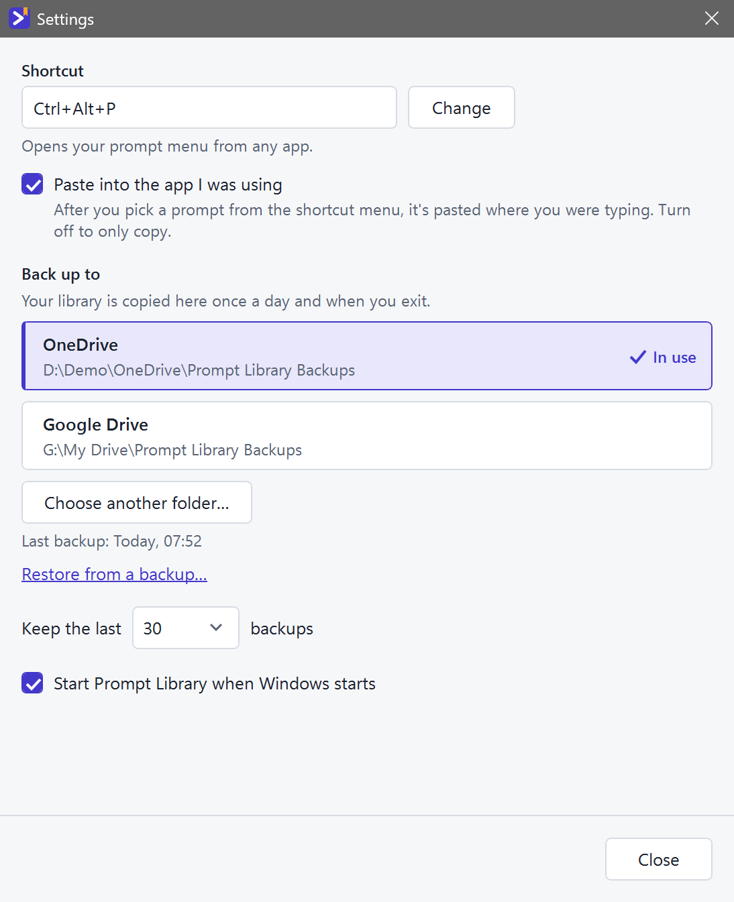</td>
  </tr>
  <tr>
    <td width="50%" valign="top">
      <h3>🛟 Never lose your work</h3>
      
Every save is written safely to disk. Before any restore, your current library is kept as a safety copy. Unsaved edits are rescued even if Windows logs off or an update closes the app.

    </td>
    <td width="50%" valign="top">
      <h3>🔒 Private by default</h3>
      
No account. No sign-in. No tracking. Your prompts live on your PC and in the backup folder you choose, and nowhere else. If you join a team library, the app only reads the team's shared file; your own prompts are never written to it. Once a day the app asks GitHub whether a newer version exists; nothing about you or your prompts is sent.

    </td>
  </tr>
  <tr>
    <td>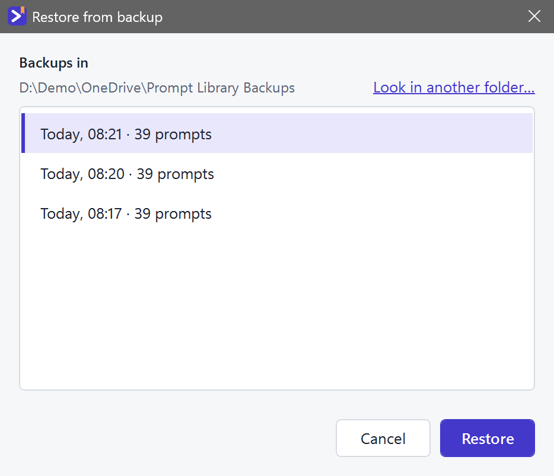</td>
    <td>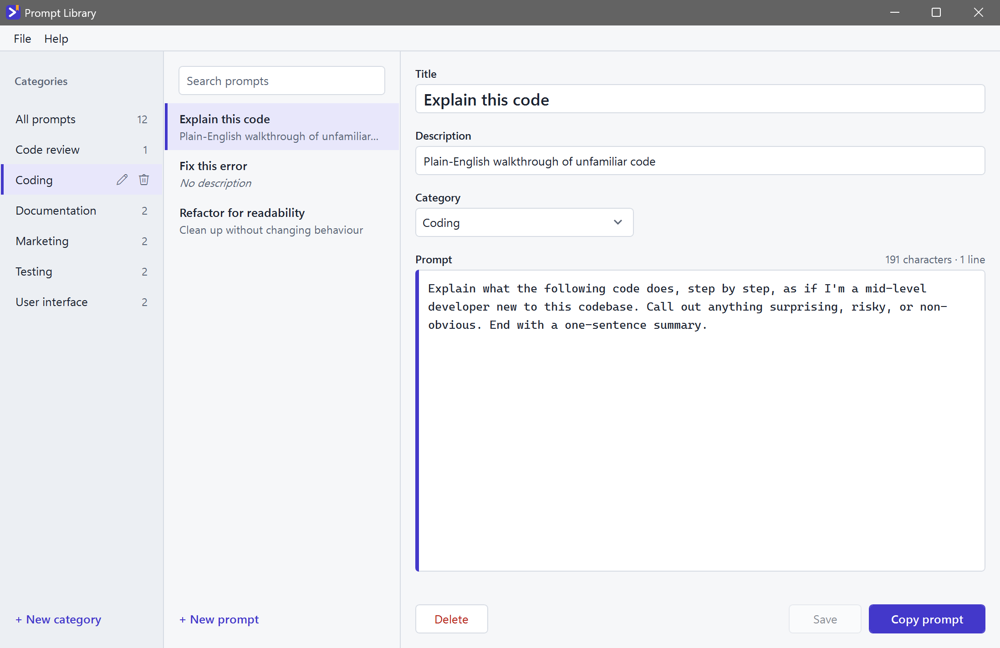</td>
  </tr>
</table>

 

## Share best-practice prompts with your team

**New in 1.1.** One person keeps the team's proven prompts in a shared folder (a network drive, or a OneDrive, Google Drive or Dropbox folder) and everyone gets them, in the main window, in search and in the shortcut menu. Team prompts update by themselves, keep working offline, and can't be changed by accident. Your own prompts stay yours, right next to them.

<table>
  <tr>
    <td width="50%" valign="top">
      <h3>👥 Team prompts, side by side with yours</h3>
      
Switch between <b>Your prompts</b> and <b>Team prompts</b> (<kbd>Ctrl</kbd> + <kbd>1</kbd> / <kbd>Ctrl</kbd> + <kbd>2</kbd>). Team prompts carry a team icon and open read only. <b>Make my copy</b> gives you your own version to change, <b>Pin</b> puts favourites at the top of the menu, and <b>Hide from menu</b> tidies away the ones you don't use. New and updated prompts get a quiet tag until you've seen them.

    </td>
    <td width="50%" valign="top">
      <h3>✏️ Curated in the app, safely</h3>
      
Whoever can change files in the shared folder can choose <b>Edit team library</b>: every save goes to everyone. Nobody overwrites anyone: if someone else saved first, your change is kept and you save again. Every save keeps a copy, so <b>Restore an older version</b> undoes anything, and copies left by file sync can be reviewed.

    </td>
  </tr>
  <tr>
    <td>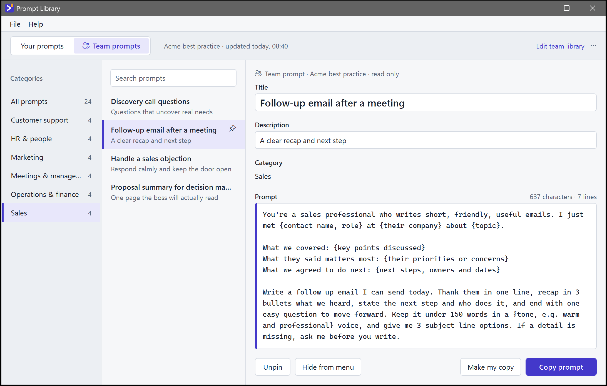</td>
    <td>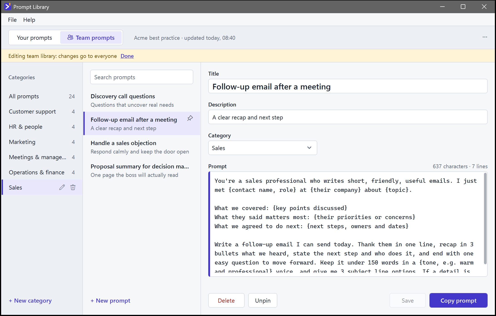</td>
  </tr>
  <tr>
    <td width="50%" valign="top">
      <h3>🔗 Join with one box</h3>
      
Settings → Team prompts → <b>Join a team library</b>, paste or browse to the shared folder (or a direct link to the file), and Join. OneDrive and Google Drive share pages aren't direct links, so use the synced folder for those. Starting one is just as quick: pick the folder, name it, and begin with 24 example business prompts for sales, support, marketing, management, HR and operations, or copy in your own categories.

    </td>
    <td width="50%" valign="top">
      <h3>⌨️ In the shortcut menu too</h3>
      
Pinned prompts come first, then the team's categories and your own, under "Team prompts" and "Your prompts" headings. A big team library folds into one submenu, so it never pushes your own prompts off the screen.

    </td>
  </tr>
  <tr>
    <td>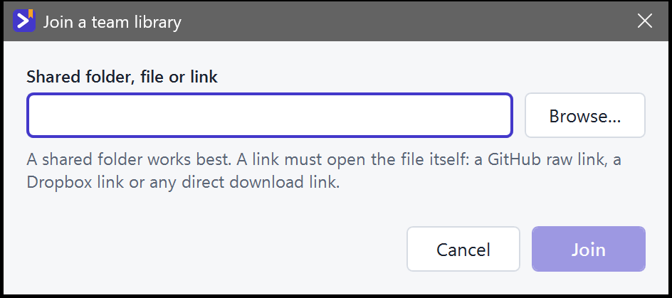</td>
    <td align="center">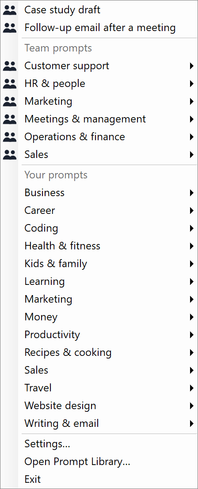</td>
  </tr>
</table>

 

## Made for people who use AI every day

You start with 39 ready-made prompts across 13 categories, so it's useful from the first minute.

- **Business owners and marketers** planning content, writing ad copy, testing ideas and setting prices.
- **Busy people and parents** planning the week, the meals, the trip and the kids' party.
- **Students and lifelong learners** turning any topic into a plan, an explanation or a quiz.
- **Job seekers** tailoring a CV, practising interviews and preparing to ask for a raise.
- **Developers** pasting go-to prompts straight into Claude Code, Copilot Chat or the terminal.
- **Small teams** (about 5 to 50 people) who want everyone using the same proven prompts.
- **Anyone** who's tired of rewriting the same instructions from memory.

  
<b>See all 39 starter prompts</b>

   

| Category | Prompts |
| --- | --- |
| Marketing | Social media content calendar · Ad copy in five angles · Ideal customer profile |
| Website design | Plan a landing page · Review my homepage · Colours and fonts |
| Productivity | Plan my week · Break down a big task · Turn notes into actions |
| Kids & family | Party games for kids · Rainy-day activities · Personalised bedtime story |
| Recipes & cooking | Cook with what I have · Weekly meal plan · Adapt a recipe |
| Business | Test a business idea · SWOT analysis · Set my prices |
| Writing & email | Reply to an email · Make this sound better · Summarise this |
| Learning | Explain it simply · Make me a study plan · Quiz me |
| Health & fitness | Beginner workout plan · Build a healthy habit · Desk stretch routine |
| Travel | Plan a trip itinerary · Packing list · Local tips and phrases |
| Money | Make a monthly budget · Savings goal plan · Help me decide on a purchase |
| Career | Tailor my CV to a job · Interview practice · Ask for a raise |
| Coding | Explain this code · Fix this error · Review my code |

Each one has `{placeholders}` where your details go, tells the AI exactly what to produce, and is yours to edit, rename or delete.

 

## Questions

  
<b>Which apps does it work with?</b>

   
  Any app where you can type: browsers (ChatGPT, Claude, Gemini, Copilot on the web), Claude Code, VS Code, Windows Terminal, Notepad, Word, Slack. The one exception is apps running as administrator. Windows doesn't let normal apps type into them, so the prompt is copied and you press <kbd>Ctrl</kbd> + <kbd>V</kbd>.

  
<b>Can I just copy, without the automatic paste?</b>

   
  Yes. Turn off "Paste into the app I was using" in Settings, and picking a prompt only copies it.

  
<b>How does a team share prompts?</b>

   
  One person chooses Settings → Team prompts → <b>Start a team library</b> and picks a folder the team can open (a network drive, or a shared OneDrive, Google Drive or Dropbox folder). Everyone else chooses <b>Join a team library</b> and picks the same folder. A public link to the file also works if it opens the file itself (a GitHub raw link or a Dropbox link); OneDrive and Google Drive share pages don't, so use the synced folder. Who can edit is decided by the folder's own sharing: if your PC can change the file, you see <b>Edit team library</b>.

  
<b>The shortcut does nothing. What now?</b>

   
  Another app probably took <kbd>Ctrl</kbd> + <kbd>Alt</kbd> + <kbd>P</kbd> first; Prompt Library shows a notice when that happens. Open Settings, choose <b>Change</b> next to Shortcut and press a new combination. If that one is taken too, it tells you and suggests a free one. Meanwhile, clicking the tray icon opens the same menu.

  
<b>Where are my prompts stored?</b>

   
  On your PC, in <code>%APPDATA%\PromptLibrary</code> (<code>library.json</code> is your library). With backups on, a copy also goes to the folder you chose, once a day and when you exit.

  
<b>What if the team folder can't be reached?</b>

   
  Team prompts keep working from the last copy your PC saw, offline or not. The Team side says when it last updated, with <b>Retry</b>. When the folder is back, new and changed prompts arrive by themselves.

  
<b>What happens if I leave a team library?</b>

   
  Settings → Team prompts → <b>Leave team library</b>. The team's prompts disappear from your PC; any copies you made with <b>Make my copy</b> stay in your own prompts. Nothing changes for the rest of the team.

  
<b>How do I get new versions?</b>

   
  Prompt Library checks for a new version once a day (or choose Help → Check for updates…). When one is out, choose <b>Update now</b>: it downloads the installer, checks it, closes the app safely and installs. Your prompts and settings are kept. Versions before 1.0.2 don't have this yet, so install 1.0.2 or later by hand once. See <a href="https://github.com/darretking/prompt-library/releases">what's new in each release</a>.

  
<b>Why not a right-click menu inside other apps?</b>

   
  Windows doesn't allow one app to add items to another app's right-click menu. A single shortcut works the same everywhere instead.

  
<b>What happens if my PC dies?</b>

   
  If backups are on, install Prompt Library on the new PC, open <b>File → Restore from backup…</b> and pick your cloud folder. Everything comes back.

  
<b>How do I uninstall? Does it delete my prompts?</b>

   
  Windows Settings → Apps → Installed apps → Prompt Library → <b>Uninstall</b>. That removes the app, its Start menu shortcut and its "start with Windows" entry. Your prompts and backups are kept, so reinstalling picks up where you left off. To remove them too, delete the <code>%APPDATA%\PromptLibrary</code> folder.

  
<b>Is it free?</b>

   
  Yes. No account, no subscription. It's open source under the GNU GPL v3: you can use, study, change and share it, and anyone who shares a changed version must share its source code too.

 

## Help and feedback

- 🐛 [Report a bug or suggest an idea](https://github.com/darretking/prompt-library/issues)
- 📦 [Releases and what's new](https://github.com/darretking/prompt-library/releases)
- 🧭 In the app: **Help → Setup guide…** runs setup again; **Help → Check for updates…** looks for a new version now.

 

## For developers

Prompt Library is a C# / WPF app on .NET 10 with a fully tested core library. Build instructions, the project layout, the installer and the roadmap are in **[Developing Prompt Library](docs/DEVELOPMENT.md)**. Ideas and bug reports are welcome in [issues](https://github.com/darretking/prompt-library/issues).

 

  Made by <a href="https://github.com/darretking">@darretking</a> · Free and open source under the <a href="LICENSE">GNU GPL v3</a>

