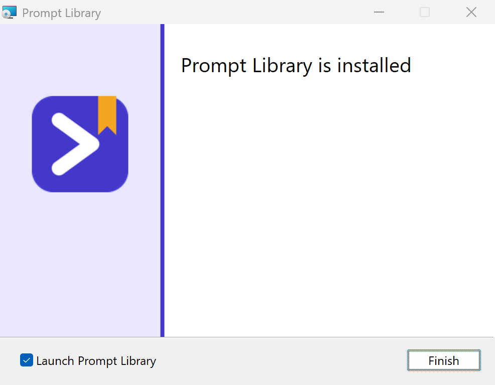
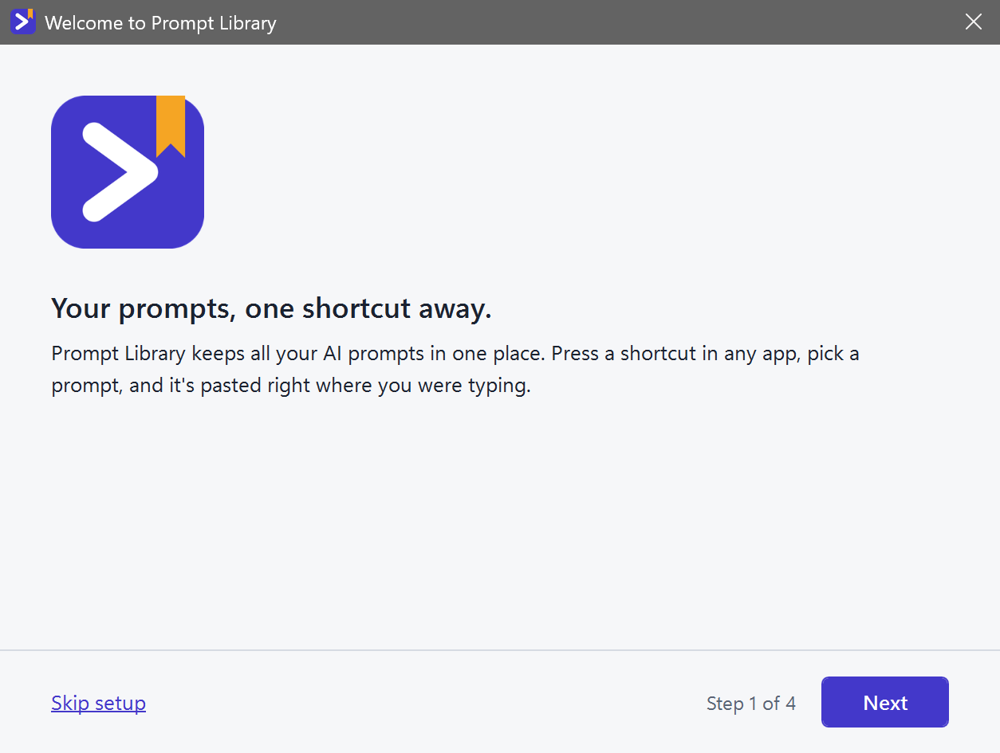
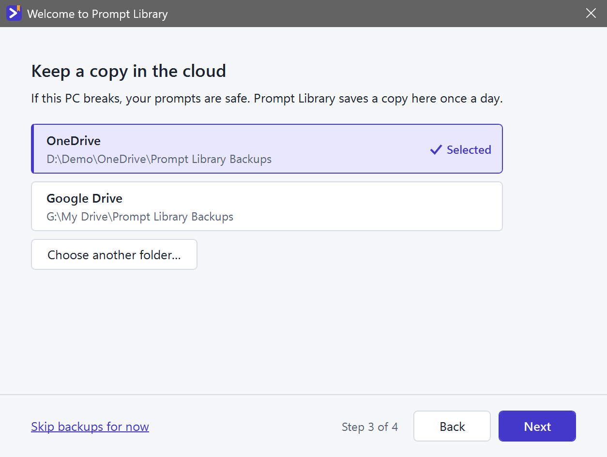

# Prompt Library

### Your best AI prompts, one shortcut away.

Press <kbd>Ctrl</kbd> + <kbd>Alt</kbd> + <kbd>P</kbd> in any app, pick a prompt, and it's pasted right where you were typing. 
ChatGPT, Claude, Copilot, your terminal, your IDE: one library for all of them.

  

  
  
  
  
  

 

## Stop hunting for that prompt

You've written a prompt that works. Then it disappears into a notes app, a chat history, a text file on the desktop, a doc you can't find. Next time you need it, you rewrite it from memory, and it's never quite as good.

**Prompt Library keeps every prompt in one place and puts it in front of you the moment you need it,** without leaving the app you're in.

 

## How it works

<table>
  <tr>
    <td width="33%" align="center"><h3>1. Press the shortcut</h3><kbd>Ctrl</kbd> + <kbd>Alt</kbd> + <kbd>P</kbd> in any app: browser, terminal, IDE, chat window.</td>
    <td width="33%" align="center"><h3>2. Pick a prompt</h3>A menu opens at your mouse. Choose a category, then the prompt.</td>
    <td width="33%" align="center"><h3>3. It's pasted</h3>Straight into the box you were typing in. Edit it and hit send.</td>
  </tr>
</table>

  

 

## Everything you need, nothing you don't

<table>
  <tr>
    <td width="50%" valign="top">
      <h3>⚡ Works in every app</h3>
      
One shortcut, everywhere. No browser extension, no plugin per tool, no copy-paste dance. If you can type in it, Prompt Library can paste into it.

    </td>
    <td width="50%" valign="top">
      <h3>🔎 Find any prompt in a second</h3>
      
Search across titles, descriptions and the prompt text itself. Organise prompts into your own categories: Marketing, Recipes, Travel, Coding, whatever fits your life and work.

    </td>
  </tr>
  <tr>
    <td></td>
    <td></td>
  </tr>
  <tr>
    <td width="50%" valign="top">
      <h3>✍️ Write once, reuse forever</h3>
      
A clean editor that keeps your prompt exactly as you wrote it: line breaks, tabs, code blocks, quotes and emoji. What you see is exactly what gets pasted.

    </td>
    <td width="50%" valign="top">
      <h3>☁️ Backups that set themselves up</h3>
      
Prompt Library finds your OneDrive, Google Drive, Dropbox or iCloud Drive folder by itself. One click, and your library is backed up every day. A new PC? Restore it in seconds.

    </td>
  </tr>
  <tr>
    <td></td>
    <td></td>
  </tr>
  <tr>
    <td width="50%" valign="top">
      <h3>🛟 Never lose your work</h3>
      
Every save is written safely to disk. Before any restore, your current library is kept as a safety copy. Unsaved edits are rescued even if Windows logs off or an update closes the app.

    </td>
    <td width="50%" valign="top">
      <h3>🔒 Private by default</h3>
      
No account. No sign-in. No tracking. No servers. Your prompts live on your PC and in the backup folder you choose, and nowhere else.

    </td>
  </tr>
  <tr>
    <td></td>
    <td></td>
  </tr>
</table>

 

## Ready in under a minute

Install it, and a short setup gets you going: try the shortcut, pick where backups go, and you're done. You start with 39 ready-made prompts across 13 categories, from marketing and business to recipes, travel, kids' games and personal productivity, so it's useful from the first minute.

<table>
  <tr>
    <td></td>
    <td></td>
  </tr>
</table>

<table>
  <tr>
    <td></td>
    <td></td>
  </tr>
  <tr>
    <td></td>
    <td></td>
  </tr>
</table>

 

## Made for people who use AI every day

- **Business owners and marketers** planning content, writing ad copy, testing ideas and setting prices.
- **Busy people and parents** planning the week, the meals, the trip and the kids' party.
- **Students and lifelong learners** turning any topic into a plan, an explanation or a quiz.
- **Job seekers** tailoring a CV, practising interviews and preparing to ask for a raise.
- **Developers** pasting go-to prompts straight into Claude Code, Copilot Chat or the terminal.
- **Anyone** who's tired of rewriting the same instructions from memory.

  
<b>See all 39 starter prompts</b>

   

| Category | Prompts |
| --- | --- |
| Marketing | Social media content calendar · Ad copy in five angles · Ideal customer profile |
| Website design | Plan a landing page · Review my homepage · Colours and fonts |
| Productivity | Plan my week · Break down a big task · Turn notes into actions |
| Kids & family | Party games for kids · Rainy-day activities · Personalised bedtime story |
| Recipes & cooking | Cook with what I have · Weekly meal plan · Adapt a recipe |
| Business | Test a business idea · SWOT analysis · Set my prices |
| Writing & email | Reply to an email · Make this sound better · Summarise this |
| Learning | Explain it simply · Make me a study plan · Quiz me |
| Health & fitness | Beginner workout plan · Build a healthy habit · Desk stretch routine |
| Travel | Plan a trip itinerary · Packing list · Local tips and phrases |
| Money | Make a monthly budget · Savings goal plan · Help me decide on a purchase |
| Career | Tailor my CV to a job · Interview practice · Ask for a raise |
| Coding | Explain this code · Fix this error · Review my code |

Each one fills in your details through `{placeholders}`, tells the AI exactly what to produce, and is yours to edit, rename or delete.

 

## Get started

1. **[Download the installer](https://github.com/darretking/prompt-library/releases/latest)** (`PromptLibrary-Setup.msi`).
2. **Run it.** It installs just for you, so no admin rights are needed.
3. **Follow the short setup**, then press <kbd>Ctrl</kbd> + <kbd>Alt</kbd> + <kbd>P</kbd> anywhere.

  
Windows says "Windows protected your PC"?

   
  The installer isn't code-signed yet, so SmartScreen doesn't recognise the publisher. Choose <b>More info</b>, then <b>Run anyway</b>.

  
Prefer a single file, no installer?

   
  Build <code>PromptLibrary.exe</code> yourself (see <a href="docs/DEVELOPMENT.md">Developing Prompt Library</a>) and run it. It's self-contained: no .NET install needed.

 

## Questions

  
<b>Which apps does it work with?</b>

   
  Any app where you can type: browsers (ChatGPT, Claude, Gemini, Copilot on the web), Claude Code, VS Code, Windows Terminal, Notepad, Word, Slack. The one exception is apps running as administrator. Windows doesn't let normal apps type into them, so the prompt is copied and you press <kbd>Ctrl</kbd> + <kbd>V</kbd>.

  
<b>Can I just copy, without the automatic paste?</b>

   
  Yes. Turn off "Paste into the app I was using" in Settings, and picking a prompt only copies it.

  
<b>Can I change the shortcut?</b>

   
  Yes, in Settings → Change. If another app already uses the keys you press, Prompt Library tells you and suggests a free combination.

  
<b>Why not a right-click menu inside other apps?</b>

   
  Windows doesn't allow one app to add items to another app's right-click menu. A single shortcut works the same everywhere instead.

  
<b>What happens if my PC dies?</b>

   
  If backups are on, install Prompt Library on the new PC, open <b>File → Restore from backup…</b> and pick your cloud folder. Everything comes back.

  
<b>Does uninstalling delete my prompts?</b>

   
  No. Uninstalling removes the app and keeps your prompts and backups.

  
<b>Is it free?</b>

   
  Yes. No account, no subscription. It's open source under the GNU GPL v3: you can use, study, change and share it, and anyone who shares a changed version must share its source code too.

 

## For developers

Prompt Library is a C# / WPF app on .NET 10 with a fully tested core library. Build instructions, the project layout, the installer and the roadmap are in **[Developing Prompt Library](docs/DEVELOPMENT.md)**. Ideas and bug reports are welcome in [issues](https://github.com/darretking/prompt-library/issues).

 

  Made by <a href="https://github.com/darretking">@darretking</a> · Free and open source under the <a href="LICENSE">GNU GPL v3</a>

